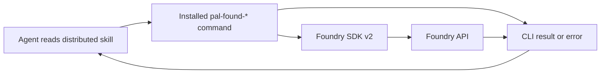

# Architecture analysis: Offline Foundry skill knowledge

| Field | Value |
| --- | --- |
| Document ID | SA-ANA-013 |
| Feature | FEATURE-012 |
| Epic | EPIC-012 |
| Status | Closed; Project Owner approved in QUESTION-156 |
| Date | 2026-10-03 |
| Sources | FEATURE-012, BA-ANA-013, FEATURE-008/009/011, current skill and CLI trees |

## 1. Scope and current state

FEATURE-012 asks each distributed skill to give an agent with no Foundry knowledge enough context to choose a supported operation, supply meaningful inputs, anticipate its effect, and interpret its result without a network or another guide. It expands the brief platform and capability descriptions from FEATURE-008 and the JSON and parameter guidance from FEATURE-009. It does not request a new Foundry operation, API, permission, or agent model setting.

The current `pal_found_cli_skills/.agents/skills/` tree has one general `pal-found/SKILL.md` and 18 namespace `SKILL.md` files. No skill folder currently ships local reference parts. The general skill lists 351 implemented operations across 18 CLI namespaces and marks `geo` and `core` as zero-operation namespaces. It also distinguishes the installed eight-operation Widgets surface from the older 12-operation design catalogue. The 18 installed `pal-found-*` commands in `pal_found_cli_tool` supply the executable behavior. Their parsers and dispatch tables, including `OP_SPECS` where used, define the supported command inventory; the skills are documentation.

Existing namespace skills list operations, options, and some policy details. For example, Datasets names 33 operations and describes `--branch-name` only as an option; its file upload example does not explain the Foundry transaction or returned outcome. Ontologies names 67 operations and groups its JSON flags; an unfamiliar agent cannot infer each flag's Foundry meaning from that list. Widgets gives more effect and retry detail, but does not explain each result field and follow-up. This sampling shows that syntax coverage alone cannot satisfy FEATURE-012. The full inventory needs review in design and verification.

## 2. Affected components and interfaces

| Component or interface | Architecture impact |
| --- | --- |
| General `pal-found` skill | Explain Foundry resources, identifiers, relationships, authorization boundaries, output conventions, and navigation to namespace guidance. |
| 18 namespace skills | Explain each capability's lifecycle and each supported operation's resource, preconditions, inputs, effects, side effects, result, and failure interpretation. Preserve existing invocation and format guidance. |
| Installed `pal-found-*` commands | Remain the callable interface and primary evidence for command names, required and optional inputs, defaults, validation, output formatting, and error mapping. No behavior change is proposed by this analysis. |
| Foundry SDK v2 and official Palantir documentation | Evidence for server-side resource meaning and effects. Public citations support maintenance; offline instructions must contain the facts needed for use. |
| Shared CLI policy and documentation | Access-control, auth, retries, pagination, binary handling, output, and exit-code contracts affect operation outcomes and must stay consistent across skills. |
| Skill distribution and validation | Must ship every required local document and prove references resolve after copying a skill folder, if local parts are approved. |

The dependency chain is: local skill guidance selects a command and explains its meaning; the installed CLI validates and invokes an SDK method; Foundry applies authorization and operation semantics; the CLI formats the returned data or error. A successful CLI exit alone may mean request acceptance rather than completion of an asynchronous Foundry job. Guidance must identify the operation-specific status check.

## 3. General architecture approach

Use a coverage inventory keyed by installed command, resource, and operation. Each operation needs one reviewable semantic record. That record should state the affected Foundry resource and what the call reads, creates, changes, deletes, executes, or starts. It should describe persistent and external effects, the meaning and required status of positional identifiers and options, JSON payload fields and allowed variants, and units or formats. It should then explain success output, empty or partial pages, returned identifiers, pending work, relevant failures, and a coherent input-to-effect-to-result example. Shared rules may be stated once if each operation gives an explicit route to them; operation-specific exceptions stay beside the operation.

The content should teach the resource workflow, not merely reproduce generated API signatures. It needs prerequisites and ordering where two calls form one action, such as creating and committing a transaction, invoking and polling a job, or reading subsequent pages. It must say when a result proves a Foundry state change and when timeout or retry leaves the final state uncertain. Examples must use clearly illustrative identifiers. No example should imply that a caller gains permissions through documentation.

The general skill is the common vocabulary source; namespace skills apply that vocabulary to concrete operations. The authoring evidence hierarchy is: installed CLI parser and execution code for accepted syntax and local behavior; SDK v2 contract plus official Palantir material for Foundry semantics; project ADRs and shared components for local access, retry, paging, binary, and output rules. Claims with no authoritative support should be held for review rather than inferred from an operation name. Source URLs and review dates can support traceability but cannot be required at runtime.

### 3.1 Approved content model

SA-DES-009 sections 1, 3, and 6 allow a skill over 300 lines to split into linked local parts. SA-DES-011 sections 2.1 and 3 described each namespace folder as exactly one `SKILL.md`. The Project Owner approved the packaged local Markdown reference-parts option in QUESTION-152 on 2026-10-03 for FEATURE-012. Each `SKILL.md` is the entry point and must link clearly to every required part. Every referenced part must ship with the copied skill folder and be readable in a network-isolated installation. Offline verification must resolve all local links and confirm full operation coverage. Command execution remains in the installed `pal-found-*` CLI; skill folders contain no executable scripts. The design phase will specify the exact part structure without reducing coverage.

## 4. Technology stack and verification

The runtime stack remains the installed Python `pal_found_cli` package, its 18 console commands, Foundry SDK v2, and Foundry API. Skill content is Markdown in the skills repository. Verification may use repository tests or scripts during development, but the distributed skill remains documentation only. The agent needs only the distributed skill documents and installed command at use time.

Verification should use two complementary checks:

1. Inventory and link checks: enumerate commands, resource/operation pairs, positional arguments, common and operation-specific flags, JSON fields, and installed SDK differences from the current tool; compare them with the documentation inventory. Check all local links in a copied, network-isolated skill folder. Include unsupported catalogue entries such as the four unimplemented Widgets operations in the negative check.
2. Semantic review: for **every** supported operation, compare the stated Foundry effect, input meaning, result, side effects, and failure guidance with SDK and official source evidence. Then conduct safe representative offline agent exercises per capability for operation selection, valid input construction, and result interpretation. Destructive or costly effects can be checked against examples and mocks rather than issued against a real Foundry tenant.

The second check cannot be reduced to parser matching: a parser can prove that `--branch-name` is accepted but cannot prove what that branch means in Foundry. Review evidence should record the source for each substantive claim and the installed CLI version or commit used for the operation inventory. A command-surface or SDK change should trigger an affected-skill review in the same change cycle.

## 5. Migration approach

1. Baseline the 19 distributed skill files and installed CLI operation inventory. Separate implemented operations from design-only catalogue entries.
2. Build an evidence-backed content map for general concepts and each namespace's supported operations. Preserve FEATURE-008 source citations and FEATURE-009 input format coverage.
3. Apply QUESTION-152's approved content model: use `SKILL.md` as the entry point and packaged local Markdown parts where needed, respecting the composition rule and offline distribution.
4. Add explanations by capability and operation, including common policy and operation-specific exceptions. Keep command behavior in the tool.
5. Verify completeness, source traceability, CLI conformance, local reference resolution, and offline use. Review navigation and contradictions across skills.
6. Distribute revised skills with the existing copy workflow. Roll back content through the skills repository if verification fails; the installed command surface is unchanged.

This is a documentation migration. It adds no Foundry request by itself and does not change data transfer limits. Better guidance may change an agent's command choices, so paging, retries, large outputs, and status polling must disclose their request and data-volume effects where material.

## 6. Risks and dependencies

| Risk or dependency | Analysis response |
| --- | --- |
| Unsupported or stale operation appears callable | Derive the inventory from installed CLI behavior, including current Widgets drift, and compare documented entries both ways. |
| Plausible but wrong Foundry meaning | Require server-side evidence for effects, resource identifiers, payload meaning, and result interpretation; do not infer semantics from names alone. |
| Long files hide information or local parts are omitted | Apply QUESTION-152, keep navigation explicit, and verify the copied offline bundle. |
| Shared concepts conflict across 19 skills | Define common terms once and cross-check each namespace's application of them. |
| Agent overclaims success after asynchronous acceptance, retry, or timeout | Identify status checks, at-least-once retry effects, and uncertain final outcomes where relevant. |
| Permissions or policy are mistaken for capability behavior | Explain both CLI guard rejection and Foundry authorization failure without suggesting bypass or changed access. |
| Sensitive or costly examples cause unintended requests | Mark identifiers illustrative; use safe representative exercises and review side effects before live invocation. |

BA-ANA-013 BR-012-01..11 and AC-012-01..13 cover the required business behavior, including positional identifiers, common CLI options, and locally referenced parts in the offline test. The architect approved the BA analysis in QUESTION-153. The BA approved this architecture analysis in QUESTION-154. The Project Owner approved the complete SA analysis in QUESTION-156. No UX analysis sub-task is present under FEATURE-012. QUESTION-156 approval is separate from the content-model decision in QUESTION-152. Both analysis sub-tasks are Closed. QUESTION-158 records the corrected closure rule, which accepts a counterpart in Resolved or Closed; QUESTION-157 was canceled as superseded.

## 7. Traceability

| Source | Architecture conclusion |
| --- | --- |
| FEATURE-012; BA-ANA-013 | Offline agent path, operation-level meaning, result interpretation, and completeness gate. |
| FEATURE-008; BA/SA-ANA-008; SA-DES-008 | Preserve sourced platform and capability descriptions. |
| FEATURE-009; BA/SA-ANA-009; SA-DES-009 | Preserve JSON and parameter variants; consider linked parts under the composition rule. |
| FEATURE-011; SA-ANA-012; SA-DES-011 | Keep skill execution documentation-only and target installed `pal-found-*` commands; reconcile the single-file statement. |
| QUESTION-152 | Project Owner approved packaged local Markdown reference parts, offline distribution and verification, and CLI-only execution. |
| QUESTION-154 | BA approved this architecture analysis. |
| QUESTION-156 | Project Owner approved the complete architecture analysis. |
| QUESTION-157 | Canceled after the closure rule was corrected. |
| QUESTION-158 | Closed after the closure rule was corrected to accept a counterpart in Resolved or Closed. |
