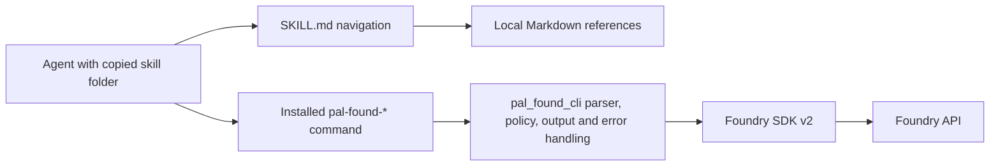
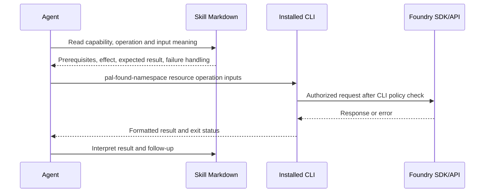

# Technical design: Offline Foundry skill guidance

| Field | Value |
| --- | --- |
| Document ID | SA-DES-012 |
| Feature / epic | FEATURE-012 / EPIC-012 |
| Status | Resolved; BA review QUESTION-159 and Project Owner approval QUESTION-160 are Closed |
| Date | 2026-10-03 |
| Basis | BA-ANA-013, SA-ANA-013, QUESTION-152, FEATURE-008/009/011 designs |

## 1. Scope and decisions

An agent with no Foundry background must be able to choose, prepare, invoke, and interpret every supported `pal-found-*` operation using the installed CLI and distributed skill files without network access. The distribution has 19 skill entry points: one platform skill and 18 namespace skills. The installed CLI exposes 351 operations. `geo` and `core` have no public CLI command, and four legacy widgets catalogue entries are absent from the installed runtime. The installed command surface, permissions, SDK dispatch, and agent model definitions remain unchanged.

QUESTION-152 approves local Markdown reference parts linked from `SKILL.md`, provided the whole skill folder ships and works offline. This supersedes the exact-one-file description in SA-DES-011 section 2.1 for this feature. SA-DES-009's 300-line composition rule still applies. A skill folder contains documentation only; the installed `pal_found_cli` package executes commands.

### 1.1 Architecture decision

Use each `SKILL.md` as a short entry point and navigation map. Put substantial platform and operation detail in `references/*.md` within that same skill folder. Keep every namespace skill independently usable: its entry point and parts explain the concepts, prerequisites, inputs, effects, outputs, failures, and follow-up needed for that namespace. The general `pal-found` skill gives the broad Foundry model and cross-capability map. Namespace skills may recommend reading it, but their required guidance cannot depend on it being loaded. This deliberately repeats a small amount of shared vocabulary; review consistency centrally.

Rejected layout: references outside a skill folder or links that require a live website. Either would fail when one folder is copied. Rejected layout: a single long `SKILL.md` per namespace. It conflicts with the 300-line composition rule and makes operation records difficult to find. The source citations remain maintenance evidence, not runtime instructions.

## 2. Components, interfaces, and deployment

| Surface | Design change |
| --- | --- |
| `pal_found_cli_skills/.agents/skills/pal-found/SKILL.md` | Introduce the platform, resource relationships, global behavior, namespace map, and links to local primer and workflow parts. |
| Each `pal-found-<namespace>/SKILL.md` | State installed command and package prerequisite, capability purpose, starting conditions, supported resource/operation map, risk cues, and links to local parts. |
| `pal-found*/references/*.md` | Hold bounded concept, workflow, and resource-client operation sections. Only relative links within the same folder are mandatory for operation. |
| `pal_found_cli_tool` | Source of parser, dispatch, common options, output/error taxonomy, access guard, retry, paging and binary behavior. No API or runtime change. |
| Foundry SDK and official Palantir documentation | Evidence for Foundry meaning, lifecycle, permission, side effect and result claims. Preserve source/version locator for maintainers. |
| Skills repository README and copy validation | Explain that the full folder, including `references/`, is copied; verify content and links after copying. |
| Parent repository | Pin reviewed skills/tool submodule commits and gitlinks for integration; no new service or deployment infrastructure. |

The existing `pal_found_cli_skills/README.md` already copies complete folders but currently verifies only 19 `SKILL.md` sentinels. Extend verification to required parts and links. The Claude Code pointer remains a link to the canonical copied `.agents/skills` tree. No executable script belongs in a distributed skill folder.

## 3. Content contract

### 3.1 Platform and capability context

The general skill explains projects/folders, datasets and transactions, Ontology types/objects/actions, compute and workflows, applications, permission boundaries, identifiers, result lifecycles, and how covered capabilities relate. Include an end-to-end map from a stated task to resource, namespace, operation and follow-up. Define terms at first use; distinguish Foundry resource IDs from local paths, names, branch names and page tokens. Explain the existing tenant URL and user-token configuration, the CLI's access-control check before an API call, and the separate Foundry authorization decision. Documentation cannot grant access.

Every namespace skill states its capability purpose, prerequisite resources and access, resource lifecycle, common operation order, neighboring capabilities, and decisions between similar actions. Put shared policy/output rules beside navigation or a local concept part. The `pal-found` overview cannot substitute for a namespace's necessary operational guidance.

### 3.2 One record for every supported operation

Use a stable heading/anchor keyed by namespace, resource client and CLI operation, for example `datasets.dataset.get-schema`. Each record contains:

1. Exact installed command path, supported variants, and affected Foundry resource. Classify it as read, create, change, delete, execute, download/upload, or status operation. State the observable effect and persistent or externally visible side effects, including writes, publication, cost or data transfer where material.
2. Preconditions and ordering: parent resource, branch, transaction, permission or access rule, valid prior state, and any follow-up operation.
3. Every positional input, flag, JSON field and relevant common option: required/default/optional status; Foundry entity or behavior it identifies; accepted form, unit or enum; effect of changing it. Preserve FEATURE-009's JSON shapes and parameter variants. Explain whether omitted and explicit values differ where source material supports that distinction.
4. Success interpretation: output format, returned identifiers/fields, empty result, page boundary/token, binary destination, asynchronous state, and what confirms completion. An exit code of zero means the CLI request completed, not necessarily that a later asynchronous Foundry process finished.
5. Failure interpretation: applicable invalid input, auth, permission, CLI access restriction, not found, rate limit, timeout and server outcomes. Explain whether the requested effect definitely did not occur, may still be pending, or requires a read/status check; never infer success from an ambiguous timeout.
6. A safe, coherent example with illustrative IDs: input meaning, expected effect, shape/meaning of result, and next action. Use mock or recorded output where live execution is unsafe.
7. Evidence locators: pinned CLI parser/dispatch location and SDK or official Foundry source for each semantic claim, with review date/version. Use a statement of uncertainty and a review Question if authoritative sources do not establish behavior; do not invent a default or side effect.

Keep local parts organized by resource client and workflow; split a part again at 300 lines. A short index table in `SKILL.md` links each resource client and its operations to the owning part. A capability flow may link across parts in the same folder. Use relative Markdown links and anchors that resolve when the folder is copied alone. Avoid absolute repository paths, remote-only prerequisites and fragile generated heading anchors for required navigation.

### 3.3 Shared options and outcomes

Explain `--timeout`, `--format`, `--pretty`, pagination and batch options only where the relevant parser supports them; namespace parsers differ. For each operation, link the applicable common-option section and list exceptions. Do not present one universal flag set as available everywhere. Distinguish JSON/TOON formatting from a Foundry state change, stdout result from stderr metadata, and nonzero CLI exits from Foundry asynchronous status. Base the exit-code table on `pal_found_cli.common.error_serializer` and ADR-001; current codes 0-9 cover success, input, authentication, permission, not found, timeout, server, rate limit, CLI access control and configuration. Document retries and their effect on uncertainty from the actual namespace/common implementation. Credentials stay in existing environment setup; examples use placeholders and no real secrets.

### 3.4 Example record shape

For `pal-found-datasets dataset get-schema <dataset_rid> --branch-name <name>`, explain that `dataset_rid` selects the dataset and `branch_name` selects the branch whose schema is read. Its success result is schema information for that selected scope; it does not write a schema. An empty or missing-schema outcome must be interpreted according to observed CLI/SDK response, not guessed. The implementer supplies a reviewed mock output and exact SDK/source evidence before publishing this entry. This example defines the documentation shape; it is not a verified claim about every possible server response.

## 4. Inventory and traceability method

The baseline is 18 installed namespace commands and these parser/dispatch operation counts: admin 66, aip_agents 15, audit 2, checkpoints 3, connectivity 20, data_health 6, datasets 33, filesystem 31, functions 7, language_models 2, media_sets 19, models 23, ontologies 67, orchestration 20, sql_queries 5, streams 15, third_party_applications 9, widgets 8. Total: 351. `geo` and `core` expose no public CLI operations. Four old widgets names (`dev-mode-settings disable`, `get`, `pause`, `set-widget-set`) belong only to the older 355-operation design catalogue; state that they are unsupported, not callable.

Derive the release inventory from each installed parser plus actual dispatch, not a handwritten total or a static legacy catalogue. Most namespace modules expose `OP_SPECS`; datasets builds subparsers with `_add_operation` and loops. Inspect parser actions to collect positional and optional inputs, defaults, required status and choices. Trace each parser operation to a dispatch path and SDK method. Compare against installed console entry points in `pal_found_cli_tool/pyproject.toml`. Record the pinned tool commit/package version and generated inventory total in release evidence. A parser-only entry with no working dispatch fails the supported-operation gate.

For every supported operation key, reviewers check one and only one reachable documentation record. The record's input table covers every parser input and consumed JSON field, plus relevant common options. Use a 351-row review register with operation key, owning part/anchor, CLI source locator, SDK/official source locator, semantic reviewer, review date, result, and later QA test-case IDs. Store durable release evidence in the relevant implementation ticket comments or stakeholder deliverable, not an undocumented side file. Coverage is bidirectional: missing records, extra callable claims, duplicate records, undocumented flags, invalid variants and stale source pins fail.

The design inspection used tool submodule `ba2f01199fbfe23b12a5dc21a3dddb60fe94bb3d`, skills submodule `7b1b99ffd6b821ed6823afdba56001c8f94e9960`, and local Foundry SDK source at `.ept/docs/customer_input/foundry-platform-python` commit `2da67907be429c35f747eef565867ce81dd2cafc`. These are starting evidence pins, not permission to reuse the 351 count after a later CLI change. For a dataset record, inspect `pal_found_cli_tool/src/pal_found_cli/datasets/scripts/pal_found_datasets_cli.py` alongside the corresponding `foundry_sdk/v2/datasets/*.py` client and the applicable official Palantir resource page. Save exact source locators in each reviewed operation record; a general platform citation alone cannot establish an operation's effect.

## 5. Verification and acceptance gates

| Gate | Required evidence |
| --- | --- |
| Inventory and syntax | Automated extraction from pinned parser/dispatch and entry points equals documented 351 baseline or records a reviewed change. Every supported operation and input maps once; four widgets legacy operations are negative checks. |
| Semantic accuracy | A human reviews every operation's resource/effect/side effect, every input's Foundry meaning, output, empty/page/pending state, failure and example against CLI, SDK and official source. Mechanical existence checks cannot certify meaning. |
| Local distribution | Copy each of 19 complete skill folders to a clean target. Validate every required Markdown part/link/anchor inside the copied folder, 300-line leaf limit, no script files or stale launcher commands, and unchanged relative navigation. Test source and copied tree. |
| Offline usability | Disable network during skill reading and use the installed CLI against mocks/recorded SDK responses. Desk-review every operation; run at least one representative agent path per namespace plus paging/empty, permission, pending, retry/timeout and binary cases. Destructive live calls are not required. Agent must choose, construct, invoke, and interpret from local docs alone. |
| Release integration | Run skills repository checks at a pinned commit, then verify parent repository gitlink points to that reviewed commit and matches the paired tool version. Validate copied distribution from that pin. |

Use the existing skills tests (`test_skill_documentation.py`, `test_skill_tree_migration.py`, `test_distribution_commands.py`) as a starting point; they currently check headings, flags and tree/copy behavior, not full semantics. Add targeted validation for the new contract during implementation. Report actual command, commit, exit code and representative mock fixtures in story comments. Never run write/delete examples against a production tenant solely to satisfy this documentation gate.

## 6. Use cases, quality and risks

| Use case | Architecture path |
| --- | --- |
| New agent selects capability | General primer maps task to Foundry resource; namespace entry point explains lifecycle and prerequisites; operation index leads to exact record. |
| Agent prepares and invokes command | Record explains each ID/option/JSON field and its effect; installed CLI performs parsing, policy check and SDK request. |
| Agent interprets outcome | Record maps formatted response, empty/page/pending/binary result or error/exit code to a safe next step. |
| Maintainer changes CLI/SDK | Inventory diff identifies affected records; reviewer updates semantics, examples and source pins; copied-folder and offline gates rerun before distribution. |

| Quality constraint | Requirement |
| --- | --- |
| Completeness | 100% of supported operation keys and applicable inputs have reviewed records; no unsupported entry is described as callable. |
| Offline independence | Each copied namespace folder alone contains all required context and working local links; no web read is required to use it. |
| Accuracy | Every semantic claim has pinned CLI and authoritative Foundry evidence; contradictory shared terms fail review. |
| Safety | Side effects, permissions, access controls, rate/data-volume effects and ambiguous outcomes appear before risky invocations. |
| Usability | `SKILL.md` entry points and leaf parts stay within 300 lines, with direct resource navigation and practical examples. |
| Maintainability | Parser/dispatch diff and source review are part of every command-surface or SDK update; release pins bind docs to tool behavior. |

Main risks are an unverified server-side meaning, source drift, a copied bundle missing a part, and a long ontology/admin file hiding an operation. Require source-backed semantic review, bidirectional inventory checks, isolated copy tests, and resource-client parts. A network-isolated mock proves guidance and CLI interpretation but cannot prove live tenant authorization or server behavior; SDK/official evidence and optional safe live tests cover that separate concern.

## 7. Implementation boundaries and migration

BA-DES-013 created DEV-STORY-041..055 for the 15 groups: 041 general primer; 042/043 disjoint admin/governance (including audit); 044 datasets; 045 filesystem; 046/047 disjoint ontology resource clients; 048 connectivity/checkpoints/data health; 049 AIP agents/functions/language models; 050 models; 051 orchestration/SQL queries; 052 streams; 053 media sets; 054 third-party applications/widgets; and 055 copied-bundle/inventory/offline integration. The pinned parser/dispatch inventory must freeze exact operation-key ownership for the two split namespaces; an informal "all other clients" boundary is insufficient for final coverage. Tech Lead inventory counted admin 38/28 and ontology 28/39 across the two groups. Each content story owns its source-backed operation records and semantic sign-off. DEV-STORY-042 owns Admin `SKILL.md` navigation to 043's governance part; DEV-STORY-046 owns Ontologies `SKILL.md` navigation to 047's action/property part. Each content group edits separate local parts. DEV-STORY-055 owns reusable validation and audits signed 351-row evidence from the 14 content stories; it does not redo every semantic review in one sprint. Its offline exercises include at least one path per each of the 18 namespaces, even when several share one content story, plus the edge cases in section 5. Grooming must confirm each story fits one sprint.

The tracker records namespace stories 042..054 as depending on 041's approved content contract, 043 on 042's entry-point navigation, 047 on 046's, and 055 on 041..054. Those links express integration order while independent namespace parts can be drafted in parallel. The stories remain New while FEATURE-012 is In Design; their current New-to-Open DoD requires Waiting for Implementation. The package and navigation checks still run on the assembled bundle before release.

Migration steps:

1. Pin the installed tool and SDK versions/commits; extract parser, dispatch, entry point and input inventory. Reconcile the 351 supported operations and unsupported widgets negatives.
2. Settle the part map and ownership with BA-DES-013. Draft the general primer and namespace entry-point contract, preserving install guidance and existing FEATURE-008/009 format/variant content.
3. Author resource-client parts with every operation record and evidence locator. Split any file over 300 lines and keep links within its skill folder. Review shared terms and cross-capability workflows.
4. Run parser/input and semantic review gates for each story. Resolve uncertainty through Questions before presenting a claim as fact.
5. Extend distribution checks, copy all 19 complete folders to a clean target, and run local-link and network-isolated agent exercises with mocks/recorded responses.
6. Review the paired skills/tool pins, update skills README/onboarding to describe the full-folder copy, merge the docs-only skills commit, then update the parent gitlink. Record release evidence and obtain the workflow's implementation/QA/deployment approvals.
7. If a published bundle fails, return the skills submodule or release tag to the last verified version and re-copy all 19 folders so stale parts are removed. Keep the installed CLI/tool version paired with that known-good documentation. Retest links and operation inventory before reuse.

No new server, credential store, Foundry endpoint, network dependency, runtime library, or CLI command is required. Repository test tooling and documentation distribution change; the skills remain Markdown-only.

## 8. Requirement traceability

| Requirement | Design sections / gate |
| --- | --- |
| BR-012-01/02/07; AC-012-01/02/09 | 3.1 capability context, 6 use cases |
| BR-012-03/04/08; AC-012-03/04/09 | 3.2 per-operation contract, 3.3 common options, 4 inventory |
| BR-012-05/06/11; AC-012-05/06/07/08/13 | 3.2 success/failure, 3.3 taxonomy, 5 semantic/offline gates |
| BR-012-09/10; AC-012-10/11/12 | 1 decision, 2 package, 4 traceability, 5 validation, 7 rollout |
| QUESTION-152 | Local parts ship with each folder; entry point and full offline link verification; CLI-only execution |
| FEATURE-008/009/011 | Retain platform/capability descriptions, JSON/variant detail, and documentation-only command model |

BA approved the technical design in QUESTION-159. The Project Owner approved it in QUESTION-160 with the exact answer "QUESTION-160: Approved". Both review Questions are Closed. BA-DES-013 approval remains separate; SA-DES-012 closure follows its current counterpart DoD.
